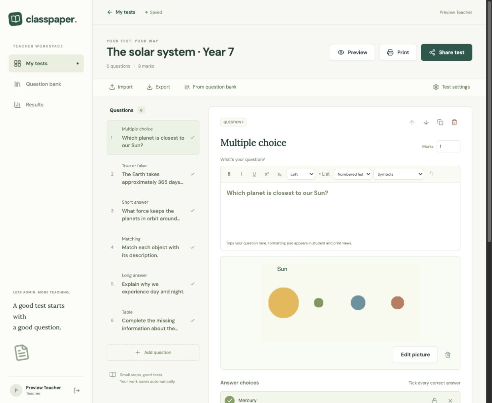
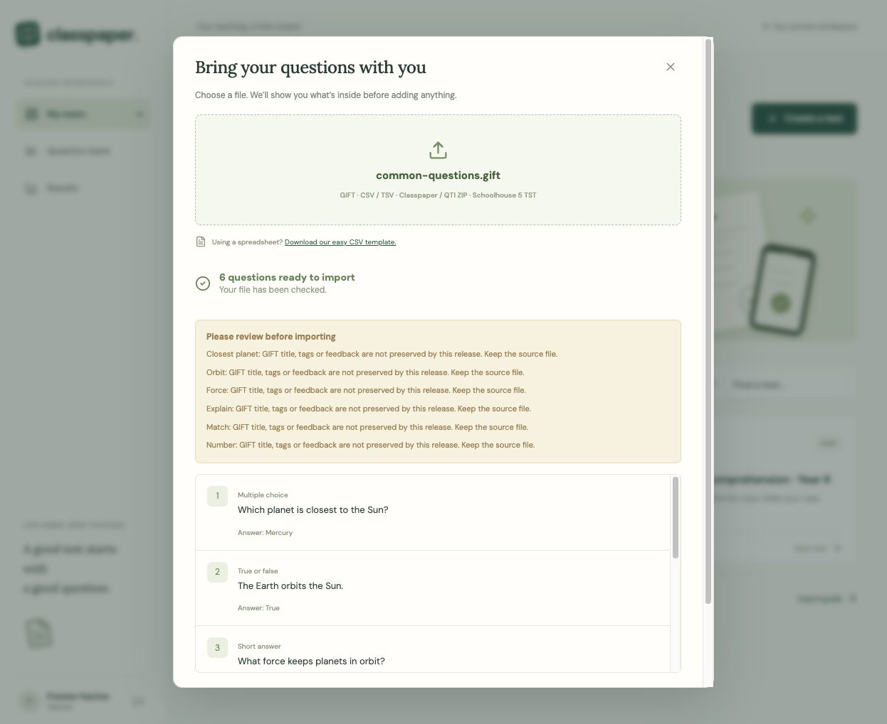
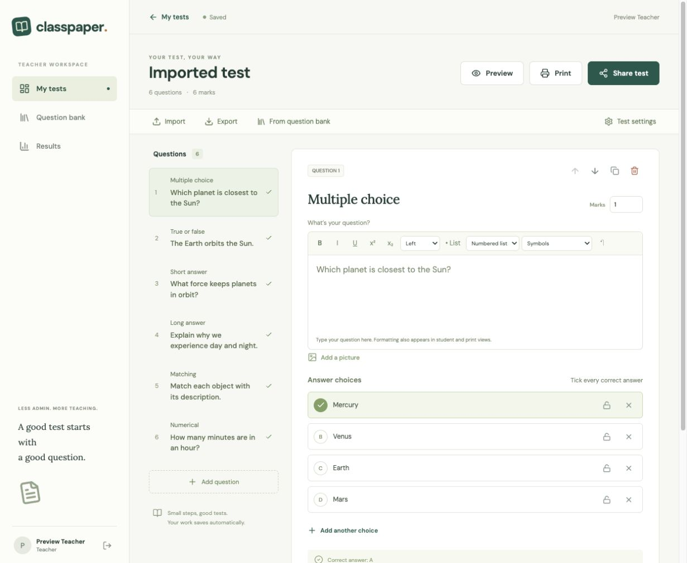
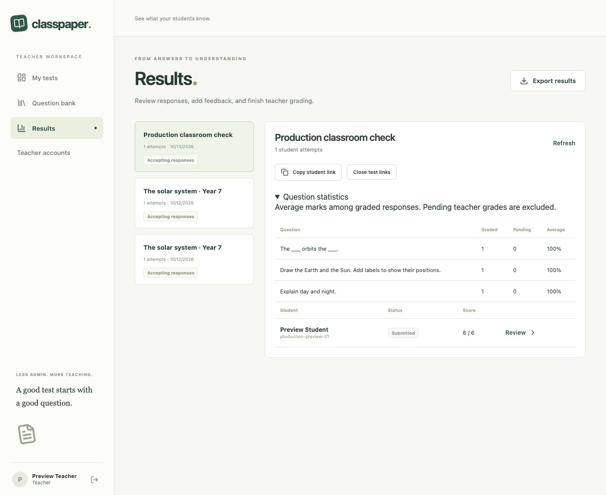
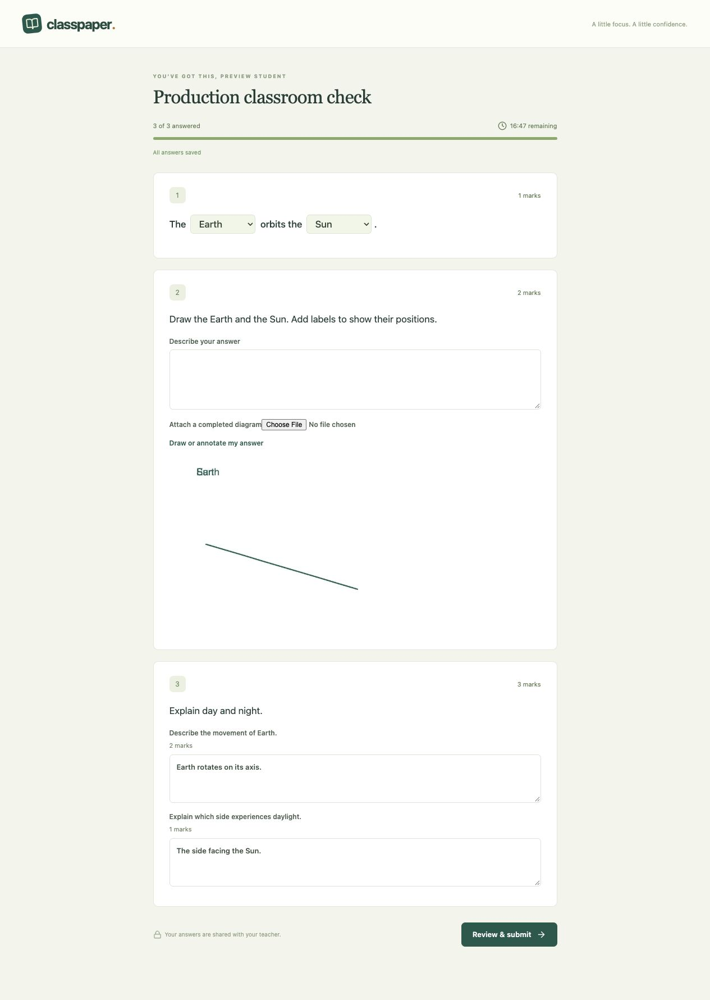

# Classpaper

**Create a test once. Print it for the classroom or share it online.**

Classpaper is a self-hosted assessment app for teachers who need clear, straightforward tools without managing a full learning management system. It combines a reusable question bank, rich question editing, guided imports, printable tests and answer keys, and quick online testing with saved responses and teacher grading.

This is a working release with deployment hardening and classroom recovery tools, not complete feature parity with Schoolhouse Test. It is an independent implementation informed by documented functionality and local file-format analysis.



## What it does

- Author 17 question types with rich text, multiple inline blanks, freehand diagram responses, pictures, grouping, marks and duplicate checks.
- Reuse questions from a searchable bank with instant previews.
- Preview imports before accepting them, with explicit reports of unsupported data or conversion losses.
- Import Aiken, GIFT, CSV/TSV, native Classpaper ZIP, a bounded QTI 2.1 subset and supported Schoolhouse 5 `.tst` structures.
- Print tests, answer sheets and keys with saved layouts and reproducible randomized versions; download server-generated PDFs or print through the browser, with automated overflow reports.
- Share quick student tests with access codes, time limits, autosaved responses and objective or teacher grading.
- Recover student attempts on another device, extend timed attempts, grade individual parts and view item averages.
- Manage teacher accounts and issue single-use password recovery links.
- Retain original import files privately for migration review.
- Export questions/results as CSV, full native packages, supported GIFT/QTI questions and eligible ZipGrade keys.

## GIFT import, tested

The included [sample file](app/test/fixtures/common-questions.gift) imports six common types: multiple choice, true/false, short answer with accepted alternatives, essay, matching and numerical. Automated tests check answer mappings, category retention, Unicode/escaped reserved characters, malformed questions and explicit rejection of unsupported partial-credit weights. A browser walkthrough uploaded the file, reviewed its six questions and acknowledged conversion warnings before creating the test.





GIFT support is a tested subset. Titles, feedback, tags and formatting can be lost with warnings. Full Moodle interoperability has not been established.

## Quick start

Requires Node.js 22 or later.

```sh
git clone https://github.com/juangrukat/classpaper.git
cd classpaper/app
npm ci
npm run dev
```

Open http://localhost:3100 and create the first teacher account. Local data uses persistent embedded PostgreSQL (PGlite). For a production frontend build, run `npm run build` followed by `npm start`.

For Docker with PostgreSQL:

```sh
cd classpaper/app
cp .env.example .env
# Set a unique POSTGRES_PASSWORD in .env.
docker compose up --build -d
```

See the [deployment and capability guide](app/README.md) for HTTPS configuration, registration controls, backups and format limitations. The Dockerfile was built and launched through Podman with PostgreSQL 17. A real database dump was restored into a fresh database and verified through the app. See [deployment instructions](docs/production/deployment.md) and [verification evidence](docs/production/verification.md).

## Verification and status

The production frontend builds successfully. On 2026-10-13, all **32 automated checks** passed locally, covering question scoring, private answer concealment, imports, randomization and the teacher/student API lifecycle. Browser walkthroughs cover editing, GIFT/CSV import, sharing, submission, manual grading, picture editing and mobile-width save/resume.

A clean clone runs 31 checks and skips one optional migration check that requires the original proprietary sample files; these are intentionally not distributed. Detailed evidence and remaining checks are in [verification notes](docs/verification.md).

Completed **24/30 documented outstanding outcomes (80%)**, including container/PostgreSQL/restore validation, account recovery, classroom controls, PDF rendering and high-value editing improvements. [Tracked backlog and acceptance evidence](docs/production/backlog.md).

A 50-student concurrent start/save/submit check passed with no failed requests. Chromium-generated 45-question PDFs were checked for A4/Letter paper in one/two columns. Local tests exercise security boundaries, recovery token rotation, grade limits and retained-file ownership. CI builds/tests the source and runs a Docker/PostgreSQL smoke test.

Six outcomes remain open: broader GIFT/QTI interoperability, fuller Schoolhouse migration, arbitrary table layouts, actual ZipGrade scanning and representative teacher/student usability/accessibility testing. Configure your real domain, HTTPS and backups before admitting real students; no public production server has been deployed.





## Source layout

- `app/src`: React and TypeScript teacher/student UI.
- `app/server`: Express API, PostgreSQL storage and interchange adapters.
- `app/test`: automated checks and distributable fixtures.
- `docs`: implementation/design notes, verification and screenshots.

Original installers, extracted third-party binaries/assets, local databases, environment secrets and student responses are excluded from this repository. Dependency licenses remain with their respective projects. No project license has been selected yet.
